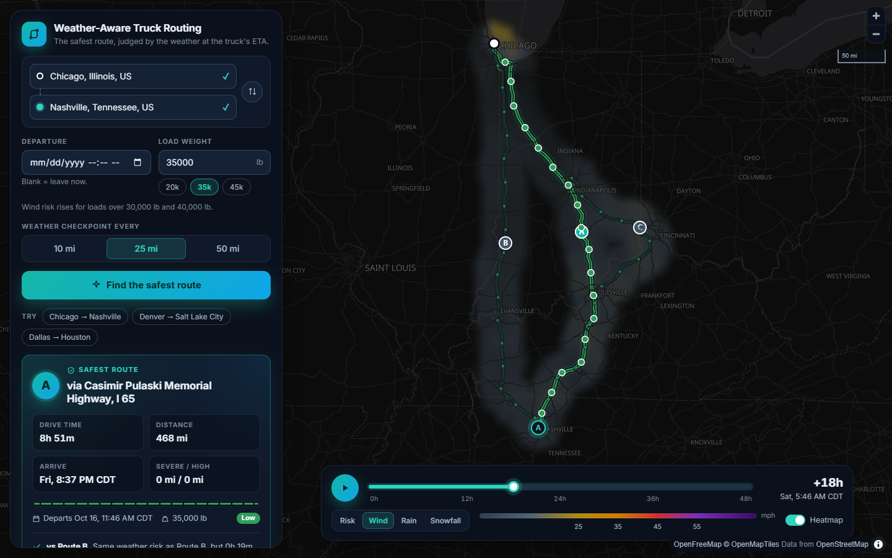
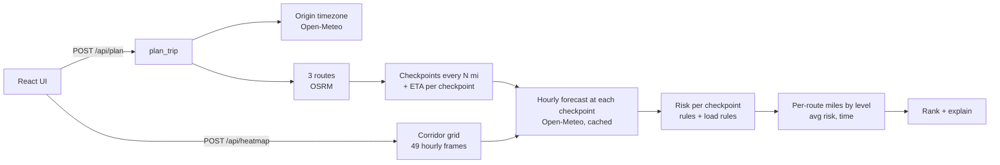

# Weather-Aware Truck Routing

A React + Django web app that helps a truck driver choose the safest route. It weighs
the **weather the truck will actually drive through**, the **load weight**, and the
**travel time**.

Enter an origin, a destination, a departure time and a load weight. The app returns three
route options and checks the forecast at regular checkpoints along each one, at the time
the truck is expected to reach each checkpoint. It scores the risk with the provided
rules and recommends a route, explaining why it won. Everything is drawn on a map, with
a corridor weather heatmap and a 0–48 h forecast slider.



- **Live demo:** _add the hosted URL after deploying (see [Deployment](#deployment))_
- **Walkthrough video:** _add the Loom link_ (talking points: [docs/WALKTHROUGH.md](docs/WALKTHROUGH.md))

---

## Features

| Requirement | Implementation |
| --- | --- |
| Origin, destination, departure time, load weight | Address autocomplete. Departure is the wall-clock time **at the origin** (blank = leave now). Load is entered in lb, with presets. |
| 3 route options from a routing API | OSRM alternatives, topped up with "via" detours when OSRM returns fewer than 3 (see below). |
| Sample weather every 10 / 25 / 50 miles at the truck's ETA | User-selectable interval. Each checkpoint's ETA comes from the router's per-segment drive times, and the forecast is read **for that hour**. |
| Risk from the risk/load rules | Pure, unit-tested rules engine with the boundary handling documented below. |
| Recommend the best route, balancing risk and time | Lexicographic ranking in the brief's order, with a plain-English reason for each comparison. |
| Routes, checkpoints, risk levels, ETAs and summaries on a map | Route lines colored by risk, checkpoint popups, route cards, and a checkpoint table linked to the map. |
| Weather heatmap along the corridor with a 0–48 h slider | Hourly forecast grid along the corridor, rendered on the client. The slider blends smoothly between hours, has playback and shows truck positions. Layers: risk / wind / rain / snow. |

---

## How it works



The plan endpoint returns first so routes appear immediately. The heatmap loads right
after it and reuses the same forecast cache.

### 1. Routes
- The app calls OSRM with `alternatives=3` and asks for full geometry and per-segment
  `distance`/`duration` annotations.
- OSRM often returns fewer than three routes. In that case it routes through **via
  points** offset to either side of the fastest route's midpoint. A candidate is kept
  only if it:
  - is at most **60% slower** than the fastest route, and
  - does not overlap any kept route for **more than 80% of its length** (overlap is
    measured with a spatial hash at 250 m tolerance).
- When a via point lands on a side road, the route goes out to it and comes back the same
  way. That out-and-back **spur is detected and trimmed**.
- **Truck speed cap:** OSRM's public profile is for cars, so every segment is capped at
  65 mph (`TRUCK_MAX_SPEED_MPH`). Segment durations are first rescaled so they add up to
  OSRM's total, which includes turn penalties.
- Routes are labeled A/B/C, fastest first.

### 2. Checkpoints and ETAs
- Checkpoints sit at mile 0, then every 10/25/50 miles, then at the destination.
- Each checkpoint **represents the stretch of road nearest to it**: half the gap on
  either side. Per-level mileage therefore always adds up to the route length, and one
  bad checkpoint counts for about one interval.
- ETA = departure + drive time to that point along the time-annotated track.

### 3. Weather at the ETA
Source: Open-Meteo hourly forecast, with units requested as mph and inches.
- **Wind:** `wind_speed_10m` (sustained), interpolated linearly between the two hours
  around the ETA. Gusts are shown alongside. Set `WIND_METRIC=gust` to score gusts
  instead.
- **Rain:** `rain + showers`. **Snow:** `snowfall`. Both are totals for the hour ending at
  each timestamp, so a 14:20 ETA uses the bucket stamped 15:00.
- Locations are snapped to a 0.1° grid (≤ ~7 km), so nearby checkpoints share one forecast.
- Each location is fetched once for a **fixed 9-day window** and cached for an hour.
  Changing the departure time or the load re-uses the cache and costs **no new API calls**.

### 4. Risk rules

| Condition | Low | Moderate | High | Severe | No Travel |
| --- | --- | --- | --- | --- | --- |
| Wind (mph) | < 25 | 25 – < 35 | 35 – < 45 | 45 – < 55 | ≥ 55 |
| Rain (in/hr) | < 0.10 | 0.10 – 0.25 | > 0.25 – 0.50 | > 0.50 – 1.00 | > 1.00 |
| Snow (in/hr) | < 0.5 | 0.5 – 1.0 | > 1.0 – 2.0 | > 2.0 – 3.0 | > 3.0 |

**Boundary convention.** The brief's table repeats each boundary value in two columns
(e.g. 0.25 appears under both Moderate and High). I resolved this from the endpoints it
states explicitly:
- Wind's top band is "≥ 55", so wind bands include their **lower** bound.
- Rain and snow use "< 0.10" and "> 1.00", so their bands include their **upper** bound.

Every boundary has a test.

**Load rules** (escalate the wind level only):
- ≥ 55 mph → No Travel for any load (this is the table's top band)
- 45–54 mph and load > 30,000 lb → No Travel
- 35–44 mph and load > 40,000 lb → Severe

A checkpoint's level is the **worst of wind, rain and snow**. Each checkpoint records the
reason for its level, e.g. *"Wind 40 mph with 42,000 lb load (> 40,000 lb)"*.

### 5. Recommendation
Routes are compared one criterion at a time, in this order. A later criterion only
decides between routes that tie on every earlier one.

0. **Fewest No Travel miles** (an addition: the brief's list doesn't mention No Travel,
   and a route with impassable stretches should never win)
1. Fewest Severe miles
2. Fewest High miles
3. Lowest average risk (distance-weighted mean of levels 0–4)
4. Shortest travel time

Mileage is compared to 0.1 mi and average risk to 0.01, so floating-point noise cannot
decide a tie. The UI states the deciding criterion against each other route, e.g. "Fewer
Severe miles than Route B: 0 mi vs 30 mi". It also warns when even the best route has
Severe or No Travel miles.

### 6. Heatmap and slider
- **Backend:** builds a lattice grid covering about 40 km around all routes. It picks the
  finest spacing (0.1°, 0.2°, …) that keeps the grid within about 220 locations, then
  returns 49 hourly frames (departure + 0…48 h) of wind, gust, rain, snow and load-aware
  risk.
- **Frontend:** renders the grid into an image client-side:
  - bilinear interpolation, with rows re-projected to Web Mercator so the image lines
    up with the basemap;
  - opacity from each pixel's distance to the nearest route, computed once per heatmap,
    so the corridor is a smooth band along the roads;
  - each whole hour painted once and cached; in-between times cross-fade the two
    neighbouring hours, so scrubbing and playback are continuous and cheap.
- The pixels are drawn into a MapLibre canvas source and copied into its texture in
  place: no PNG encoding, no network, no tile reloads.
- Each slider tick costs **about 2–3 ms of JS** in the production build. Sidebar
  components are memoised, so only the map, the timeline and the current checkpoint row
  update.
- The map library is a separate, lazily loaded chunk, so the form paints first.
- Truck markers (lightweight DOM markers) on every route move with the slider. Hovering the map shows the value
  under the cursor.

---

## API

| Method | Path | Purpose |
| --- | --- | --- |
| `GET` | `/api/health/` | Liveness check |
| `GET` | `/api/geocode/?q=nashville` | Place search (Photon / OpenStreetMap) |
| `POST` | `/api/plan/` | Routes, checkpoints, risk and recommendation |
| `POST` | `/api/heatmap/` | Corridor forecast grid for the slider |

```jsonc
// POST /api/plan/
{
  "origin":      { "lat": 41.8781, "lon": -87.6298, "label": "Chicago, IL" },
  "destination": { "lat": 36.1627, "lon": -86.7816, "label": "Nashville, TN" },
  "departure": "2026-10-17T06:00",   // origin-local; omit/null = now; "...Z" = absolute
  "load_weight_lb": 42000,
  "interval_miles": 25               // 10 | 25 | 50
}
```

The response contains `trip` (resolved UTC departure and origin timezone),
`recommendation` (route id, comparisons, warnings) and `routes[]`. Each route carries its
stats, a simplified `path` with drive time at each vertex (`path_times_s`), and
`checkpoints[]`. Each checkpoint has its mile, ETA, weather, per-condition levels and
reasons.

Errors always come back as JSON: field validation → `400 {field: [msg]}`, invalid trip →
`400 {detail, code}`, upstream API failure → `502 {detail, code}`.

---

## Running locally

**Prerequisites:** Python 3.12+ and Node 22+. No API keys are needed: every provider is
free and keyless.

```bash
# Backend (http://127.0.0.1:8000)
cd backend
python -m venv .venv
.venv/Scripts/activate            # Windows; use `source .venv/bin/activate` on macOS/Linux
pip install -r requirements-dev.txt
cp .env.example .env              # sets DJANGO_DEBUG=1
python manage.py runserver

# Frontend (http://localhost:5173, proxies /api to the backend)
cd frontend
npm install
npm run dev
```

Configuration is read from environment variables (see `backend/.env.example`):

| Variable | Default | Purpose |
| --- | --- | --- |
| `DJANGO_DEBUG` | `0` | Debug mode |
| `DJANGO_SECRET_KEY` | dev key | Set in production |
| `DJANGO_ALLOWED_HOSTS` | `localhost,127.0.0.1` | Comma-separated |
| `TRUCK_MAX_SPEED_MPH` | `65` | Per-segment truck speed cap |
| `WIND_METRIC` | `sustained` | `sustained` or `gust` |
| `HEATMAP_MAX_CELLS` | `220` | Weather-location budget for the heatmap |
| `HTTP_FORCE_IPV4` | `0` | Workaround for networks whose IPv6 path stalls TLS |
| `OSRM_BASE_URL`, `PHOTON_BASE_URL`, `OPEN_METEO_BASE_URL` | public instances | Point at self-hosted services |
| `VITE_API_BASE_URL` (frontend build) | same origin | API origin if the frontend is hosted separately |

## Tests and quality

```bash
cd backend  && ruff check . && ruff format --check . && pytest        # 108 tests
cd frontend && npm run lint && npm run typecheck && npm test            # 15 tests
```

- **Backend tests** cover:
  - every risk boundary and load rule;
  - checkpoint placement and ETAs;
  - ranking and its explanations;
  - spur trimming and via-route selection;
  - forecast time alignment, batching and caching;
  - the full API, with deterministic fake providers.
- **Frontend tests** cover the heatmap renderer (projection, interpolation, gaps,
  blending) and the route geometry and time math.
- **CI** (`.github/workflows/ci.yml`) runs all of the above, builds the Docker image and
  smoke-tests it.

## Performance

[docs/PERFORMANCE.md](docs/PERFORMANCE.md) has the full report and
[perf/](perf/README.md) has the scripts. Measured on a 2013 dual-core with
software-only WebGL, so these are worst-case numbers:

| Metric | Result |
| --- | --- |
| First plan | ~6 s, dominated by OSRM and the weather API |
| Re-plan with a new load or departure | 35–200 ms, from cache, with no upstream calls |
| Slider | ~2–3 ms of JS per tick |
| Playback | ~10 fps on this PC, limited by software rasterisation (the main thread is ~50% idle); memory stays flat |
| JS on first load | 80 KB gzipped app code; the map library loads in parallel |

## Deployment

**Vercel (Services).** `vercel.json` defines two services in one project, on one
domain:

| Service | Root | Public path | What it is |
| --- | --- | --- | --- |
| `frontend` | `frontend/` | everything except `/api/` | Vite build, served from Vercel's CDN |
| `backend` | `backend/` | `/api/(.*)` | Django as a Vercel Function; receives the full `/api/...` path |

The browser calls the API with relative `/api/...` URLs, and the backend only calls
third-party APIs, so the services don't call each other and need no bindings.

To deploy: Add New → Project → import the repo. Then in Settings → Environment
Variables, set `DJANGO_SECRET_KEY`. Hosts under `*.vercel.app` and the production
domain are allowed automatically; add any other custom domain to
`DJANGO_ALLOWED_HOSTS`.

Caveat: each function instance has its own in-memory cache, so cached routes and
forecasts are shared only within a warm instance.

**Docker (Render or any container host).** The Dockerfile builds the React app and
serves it **from Django**, so there is one service, one URL and no CORS:
- Static assets are served by WhiteNoise, pre-gzipped, with immutable caching.
- The API runs on gunicorn with threads, because the work is I/O-bound.

**Render (free):** New → Blueprint → select this repo. `render.yaml` configures the
service. Free instances sleep when idle, so the first request after a pause takes about
30–60 s.

**Any Docker host:**

```bash
docker build -t weather-truck-routing .
docker run -p 8000:8000 -e DJANGO_ALLOWED_HOSTS=localhost -e DJANGO_SECRET_KEY=change-me weather-truck-routing
```

## Project structure

```
backend/
  config/                 Django settings (env-driven), URLs, WSGI
  planner/
    domain/               Pure logic, no I/O: risk.py, geo.py, checkpoints.py,
                          recommendation.py, corridor.py
    providers/            OSRM, Photon, Open-Meteo clients + shared HTTP session
    services/             Use cases: trip.py (plan), heatmap.py
    api/                  DRF serializers, views, error handling
    tests/
frontend/src/
  api/                    Typed client + API types
  components/             Form, place autocomplete, route cards, checkpoint table, timeline
  hooks/                  usePlan, useHeatmap, usePlayback
  map/                    MapView (MapLibre), heatmapRenderer, color scales
  lib/                    Route/time math, formatting
```

## Assumptions and limitations

- **Car routing, truck speeds.** OSRM's public server only has a car profile, so it
  doesn't know about low bridges, truck-restricted roads or hazmat rules. Speeds are
  capped at 65 mph. A truck-aware router such as HERE or ORS `driving-hgv` would slot in
  behind the same `fetch_route_options` interface.
- **No hours-of-service breaks.** ETAs assume continuous driving. Adding HOS rest stops
  would shift the ETAs of long trips.
- **Forecast horizon.** Departures can be up to 7 days ahead (or 6 h in the past).
  Checkpoints beyond the forecast count as "No forecast" miles and are flagged.
- **Free API quotas.** Open-Meteo allows 600 locations per minute. Snapping, caching
  and the heatmap budget keep a typical trip under ~300. The in-process cache assumes
  one instance; scaling out would mean moving it to Redis.
- **Units.** US units throughout (mph, in/hr, lb, miles), matching the brief.
